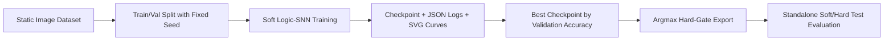

# Logic-SNN and Conv-SNN Research Baseline

A compact, reproducible spiking neural network project. MNIST and CIFAR-10 can
use differentiable logic gates during training and exportable hard-gate
inference. The original Conv-SNN remains available as a legacy baseline.

## Research Positioning

This repository is designed to show four things clearly:

- I can turn an idea into a runnable experiment instead of leaving it as a notebook fragment.
- I separate **training**, **validation**, and **test** correctly, with deterministic data splits.
- I keep dependency boundaries explicit: spiking operators come from SpikingJelly, while the experiment pipeline, evaluation protocol, and repository engineering are implemented here.
- I package results so another researcher can inspect the setup, reproduce the workflow, and extend it.

## What The Project Studies

The current research question is:

> Can convolutional and fully connected synapses be replaced by differentiable logic trees while preserving LIF temporal dynamics and enabling exact Boolean-gate inference after training?

The Logic-SNN implementation uses:

- multi-step rate-based inference with `T` repeated timesteps
- `LIFNode` or `IFNode` neurons from SpikingJelly
- surrogate gradient training with `ATan`
- soft mixtures over all 16 two-input Boolean operators
- `argmax` discretization to parameter-free truth-table logic layers
- explicit checkpointing, metric logging, SVG curves, and standalone test-set evaluation

There are no ordinary convolutions, BatchNorm, residual, attention, or dropout
blocks in a Logic-SNN. Every synaptic layer is a logic tree or a two-input
logic neuron.

## Experimental Design



Key controls:

- fixed random seed for training
- deterministic train/validation split through `--split-seed`
- no test-set leakage during training
- timestamped run directories with saved CLI arguments
- separate `test.py` for final evaluation
- Logic-SNN also writes `checkpoint_best_hard.pt` after discretization

## Repository Highlights

| Path | Why it matters |
| --- | --- |
| `train.py` | Training entry point with checkpointing, scheduler, AMP, and validation loop |
| `train_ddp.py` | Multi-GPU DistributedDataParallel training |
| `test.py` | Rebuilds the model from a run directory and evaluates soft and hard checkpoints |
| `discretize.py` | Converts a soft checkpoint into an exact Boolean-gate bundle |
| `snn_minimal/` | Data loading, training engine, plotting, and model definition |
| `scripts/summarize_runs.py` | Converts raw run artifacts into a GitHub-friendly experiment summary |
| `.github/workflows/smoke-test.yml` | CI smoke test proving the project is not documentation-only |
| `REFERENCE_NOTES.md` | Explicit upstream attribution and scope boundary |

## Quick Start

```bash
python3 -m venv .venv
source .venv/bin/activate
pip install --upgrade pip
pip install -r requirements.txt
```

Train a small Logic-SNN run:

```bash
python train.py \
  --dataset mnist \
  --model-family logic_snn \
  --data-root ./data \
  --output-dir ./runs/mnist \
  --epochs 5 \
  --batch-size 64 \
  --timesteps 4 \
  --device cpu
```

Evaluate the best checkpoint from a run directory:

```bash
python test.py \
  --run-dir ./runs/mnist/<timestamped-run> \
  --inference both \
  --device cpu
```

Logic-SNN training writes `checkpoint_best.pt` (soft gates) and
`checkpoint_best_hard.pt` (discretized gates). To discretize another soft
checkpoint explicitly:

```bash
python discretize.py \
  --checkpoint ./runs/mnist/<timestamped-run>/checkpoint_latest.pt
```

CIFAR Logic-SNN uses a capacity-scalable `pyramid` architecture:

```text
9-channel RGB thresholds
→ LogicConv(k) → LIF → pool
→ LogicConv(4k) → LIF → pool
→ LogicConv(16k) → LIF → pool
→ LogicConv(32k) → LIF → pool
→ DiffLogic(h1) → LIF
→ DiffLogic(h2) → LIF
→ DiffLogic(10 × outputs_per_class) → LIF
→ class-group / time mean
```

`--grad-accum-steps` preserves the desired effective batch size without
changing the forward network. Physical batch 16 with accumulation 4 is
equivalent to batch 64 on one GPU, or batch 128 with two GPUs.

Multi-GPU training uses one process per GPU through `train_ddp.py`. The
`--batch-size` value is per GPU and the effective optimizer batch is
`batch_size × world_size × grad_accum_steps`:

```bash
CUDA_VISIBLE_DEVICES=4,7 torchrun --standalone --nproc_per_node=2 \
  train_ddp.py \
  --dataset cifar10 \
  --model-family logic_snn \
  --logic-cifar-architecture pyramid \
  --batch-size 16 \
  --grad-accum-steps 4 \
  --resume /path/to/checkpoint_latest.pt \
  ...
```

Only rank zero writes checkpoints, logs, and plots. Training and validation
metrics are summed across all ranks; validation uses a non-padding sampler so
samples are neither omitted nor duplicated.

For long runs where the required epoch count is unknown, validation-driven
learning-rate reduction and early stopping can be used without an accuracy
target. `--min-lr` keeps the learning rate strictly positive:

```bash
python train.py ... \
  --epochs 360 \
  --lr-scheduler plateau \
  --scheduler-patience 12 \
  --scheduler-factor 0.5 \
  --min-lr 0.0001 \
  --early-stopping-patience 0
```

`--early-stopping-patience 0` disables early stopping. Omit
`--target-accuracy` when using this policy.

## Example Training Commands

MNIST identity-middle network (single GPU). The extra dense layer is the same
width as `hidden_dim` and is initialized as Boolean identity `A`:

```bash
python train.py \
  --dataset mnist \
  --model-family logic_snn \
  --data-root ./data \
  --output-dir ./runs/mnist_logic_fixed_large_100 \
  --epochs 100 \
  --batch-size 64 \
  --timesteps 4 \
  --channels 96 \
  --hidden-dim 8192 \
  --logic-hidden-dim2 8192 \
  --logic-identity-middle-init \
  --logic-outputs-per-class 2048 \
  --logic-readout-loss cross_entropy \
  --logic-readout-temperature 20 \
  --logic-gate-init normal \
  --optimizer adamw \
  --lr 0.01 \
  --weight-decay 0.002 \
  --device cuda \
  --amp
```

CIFAR-10 pyramid-m, two GPUs, cosine schedule for 300 epochs:

```bash
CUDA_VISIBLE_DEVICES=4,7 torchrun --standalone --nproc_per_node=2 \
  train_ddp.py \
  --dataset cifar10 \
  --model-family logic_snn \
  --logic-cifar-architecture pyramid \
  --data-root ./data \
  --output-dir ./runs/cifar10_logic_pyramid_m_9ch_ddp2_cosine_long \
  --epochs 300 \
  --batch-size 16 \
  --grad-accum-steps 4 \
  --timesteps 4 \
  --channels 256 \
  --hidden-dim 327680 \
  --logic-hidden-dim2 163840 \
  --logic-outputs-per-class 8192 \
  --logic-readout-loss cross_entropy \
  --logic-readout-temperature 40 \
  --logic-gate-init residual_a \
  --optimizer adamw \
  --lr 0.02 \
  --weight-decay 0.002 \
  --lr-scheduler cosine \
  --min-lr 0.0001 \
  --cifar-logic-thresholds 0.25 0.5 0.75 \
  --amp
```

Omit `--model-family logic_snn` on CIFAR-10 to retain the original Conv-SNN
default. Historical checkpoints without `model_family` continue to load as
`ConvSNN`.

A hard-aware continuation can be started from a soft checkpoint with
`--init-checkpoint <soft.pt>` and `--logic-gate-mode straight_through`. The
forward gates are exact one-hot while the backward pass uses softmax
gradients.

Refresh the tracked GitHub summary after new experiments:

```bash
python3 scripts/summarize_runs.py
```

## Reproducibility Checklist

- `args.json` stores the exact CLI configuration for each run.
- `metrics.json` stores final and best-validation checkpoints.
- `test_metrics.json` is written only by `test.py`.
- `train.log` records per-epoch metrics for later inspection.
- `train_loss.svg`, `val_acc.svg`, and `confusion_matrix.svg` are generated automatically after training.
- GitHub Actions runs a CPU smoke test to catch broken training/evaluation flows.

## Scope And Honesty

This is a **baseline research package**, not a claim of state-of-the-art performance. Its value is in:

- clear experiment boundaries
- credible implementation hygiene
- transparent attribution to upstream libraries
- a foundation for future ablations and stronger studies

## Next Research Directions

The most natural extensions from here are:

1. Close the CIFAR-10 soft–hard discretization gap without adding non-logic layers.
2. Compare `LIF` vs `IF`, and sweep `tau` and timestep count `T`.
3. Add matched-parameter ANN baselines to measure what the SNN inductive bias is actually buying.
4. Track sparsity or spike-rate statistics as a proxy for efficiency, not just accuracy.
5. Move from static-image repetition to event-based or neuromorphic datasets for a stronger temporal justification.
6. Add ablation tables and multiple random seeds to report mean and variance instead of single-run numbers.

## Additional Notes

- Upstream attribution and design boundary: [`REFERENCE_NOTES.md`](REFERENCE_NOTES.md)
- Chinese experiment note: [`SNN实验说明.pdf`](SNN实验说明.pdf)

## Dependency

This project uses [SpikingJelly](https://github.com/fangwei123456/spikingjelly) commit `b049197b9589211418940c50031d3b7acb603bd6` through `requirements.txt`.
