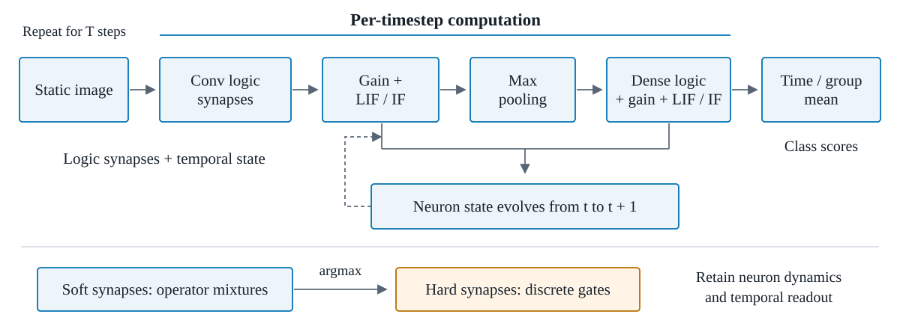
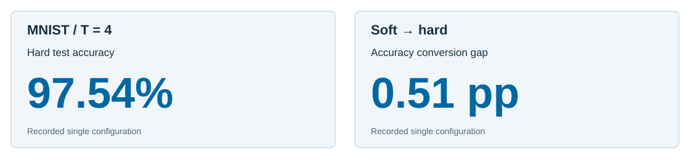

# Logic-SNN: Differentiable Logic-Gate Spiking Neural Networks

**English** | [简体中文](README.zh-CN.md)

**Discrete-capable logic synapses coupled to spiking temporal dynamics.**

A PyTorch/SpikingJelly implementation combining convolutional and dense differentiable logic gates with LIF/IF membrane dynamics. Logic layers adapt the [Conv-DLGN](https://github.com/13710833172/Conv-DLGN) research implementation; neuron models and surrogate gradients use [SpikingJelly](https://github.com/fangwei123456/spikingjelly). See [attribution](REFERENCE_NOTES.md).

## Abstract

Differentiable Boolean logic gates provide learnable synaptic operators, while spiking neural networks integrate information through evolving membrane states. Logic-SNN combines these mechanisms in a unified image classifier with spatial logic-tree synapses, dense logic gates, LIF/IF neurons, and temporal spike aggregation. Its operator mixtures can be discretized without changing the model's temporal dynamics or readout. At **four timesteps**, a reported MNIST configuration achieves **98.05% soft** and **97.54% hard test accuracy**, giving a **0.51 percentage-point** soft-to-hard conversion difference. On CIFAR-10, the evaluated pyramid configuration reaches **67.49% soft accuracy**. Together, the implementations and paired measurements establish a concrete research framework for investigating Boolean synapses within spiking computation.

## Contributions

1. **Hybrid logic-and-spike computation.** Spatial convolutional logic trees and dense logic layers drive LIF/IF neurons, coupling learned Boolean operations with stateful temporal processing.
2. **Discretization-preserving architecture.** Soft and hard synaptic layers share fixed wiring, current gain, neuron dynamics, pooling, and temporal/class-group readout, enabling matched inference-mode evaluation.
3. **Measured hybrid operating points.** Four-timestep MNIST demonstrates **97.54% hard classification accuracy**, while the CIFAR-10 experiment characterizes a deeper logic-spiking model in soft execution.

## Methodology



*Figure 1. A static image is presented at each of T timesteps. Local logic-tree and dense logic synapses provide input currents to spiking neurons, whose internal states evolve over time; class scores average output spikes across time and output groups.*

**Logic synapses.** Each binary gate learns a mixture over 16 Boolean operations. [Convolutional logic-tree layers](snn_minimal/models/logic_layers.py) combine eight fixed local leaves through seven gates. Dense logic layers use sparse fixed two-input connections. Hard export chooses the highest-logit operator per gate and retains all stored wiring.

**Spike dynamics.** Logic activations are scaled by the configured current gain and passed into LIF/IF neurons with ATan surrogate gradients. The [model forward path](snn_minimal/models/logic_snn.py) processes an identical image across timesteps, with neuron state carried between presentations and reset between separate input batches.

**Temporal readout.** For output spikes $s_{t,c,j}$ and $M$ units per class,

$$r_c=\frac{1}{TM}\sum_{t=1}^T\sum_{j=1}^M s_{t,c,j}.$$

The argmax class score yields the prediction. Gate export changes the synaptic operator representation while preserving this temporal readout.

## Experiments

**Primary finding — the exported hybrid retains high MNIST accuracy at four timesteps.**



*Figure 2. MNIST hard-mode performance and soft-to-hard gap at T = 4. CIFAR-10's separate soft-mode operating point appears in Table 1.*

| Dataset / architecture | Timesteps | Soft test accuracy ↑ | Hard test accuracy ↑ | Test samples |
|:--|--:|--:|--:|--:|
| **MNIST / large, identity-middle** | 4 | **98.05%** | **97.54%** | 10,000 |
| CIFAR-10 / pyramid-m, 9-channel input | 4 | **67.49%** | 28.76% | 10,000 |

*Table 1. Reported single configurations with their corresponding soft and hard measurements. The two dataset rows use distinct network and input settings.*

**Evidence interpretation.** The MNIST result directly supports the discrete-synapse claim: at T = 4, hard inference reaches **97.54%**, within **0.51 pp** of its soft counterpart. CIFAR-10 establishes a **67.49% soft-mode** natural-image operating point; its separately measured hard accuracy is reported explicitly for a faithful execution-mode distinction.

**Protocol.** Both rows use LIF neurons and validation-selected soft checkpoints. Results are individual configurations, not multi-seed estimates. The hard mode retains membrane dynamics and firing-rate aggregation. The repository's tracked [experiment summary](results/experiment_summary.json) pertains to conventional ConvSNN runs; Table 1 reflects the Logic-SNN configurations documented in this project's research README and supporting materials.

## Task coverage

| Model family | MNIST | CIFAR-10 | CIFAR10-DVS |
|:--|:--|:--|:--|
| `logic_snn` | Static repeated frames | Static repeated frames | — |
| `conv_snn` | Conventional baseline | Conventional baseline | Event-derived frames |

CIFAR10-DVS is implemented through the **`conv_snn`** path. Conventional static-image baselines are also packaged separately in [Conv-SNN-Baselines](https://github.com/13710833172/Conv-SNN-Baselines).

## Quick start

```bash
python3 -m venv .venv
source .venv/bin/activate
pip install -r requirements.txt

# Small execution check (restricted batches, not a paper experiment)
python train.py --dataset mnist --model-family logic_snn \
  --output-dir ./runs/mnist --device cpu --epochs 1 \
  --batch-size 8 --timesteps 2 --num-workers 0 \
  --limit-train-batches 2 --limit-val-batches 2

# Evaluate both modes from the resulting run
python test.py --run-dir ./runs/mnist/RUN_NAME \
  --inference both --device cpu --num-workers 0 --limit-test-batches 2

# Full configured training entry point for CIFAR-10 logic models
python train.py --dataset cifar10 --model-family logic_snn --device cuda

# Export your own checkpoint
python discretize.py --checkpoint ./runs/mnist/RUN_NAME/checkpoint_best.pt
python -m unittest discover -s tests -v
```

For official full-test results, omit the batch limits and use the intended T = 4 research configuration. See [technical instructions](README.technical.md) for variants and distributed training. Specify `--model-family` explicitly; CIFAR-10 defaults to a conventional baseline.

## Repository map

| Path | Purpose |
|:--|:--|
| [snn_minimal/models/logic_layers.py](snn_minimal/models/logic_layers.py) | Trainable and hard logic synapses |
| [snn_minimal/models/logic_snn.py](snn_minimal/models/logic_snn.py) | Shared temporal execution and model export |
| [train.py](train.py) · [test.py](test.py) · [discretize.py](discretize.py) | Train, paired evaluation, discrete export |
| [README.technical.md](README.technical.md) | Architecture, flags, distributed configuration |
| [REFERENCE_NOTES.md](REFERENCE_NOTES.md) | Upstream algorithms and implementation credits |

## Takeaway

**Boolean logic synapses can operate inside a stateful spiking classifier and be evaluated after discrete export.** The representative MNIST model reaches **97.54% hard test accuracy at T = 4**.
