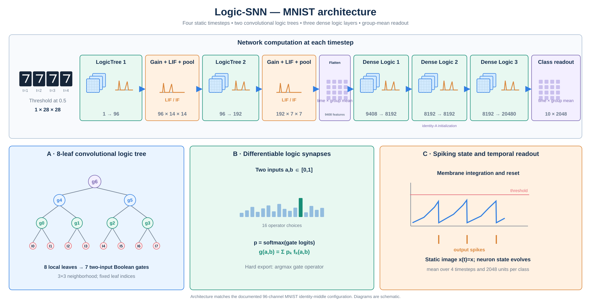
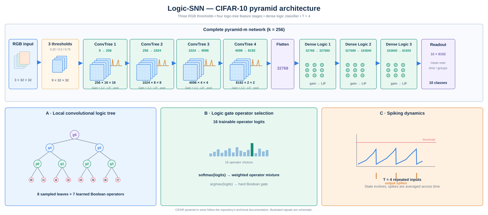

# Logic-SNN：可微逻辑门脉冲神经网络

[English](README.md) | **简体中文**

**以可学习逻辑突触连接脉冲时间动力学。**

本项目基于 PyTorch 与 SpikingJelly，将可微逻辑树突触与 LIF/IF 神经元结合。逻辑层基于 [Conv-DLGN](https://github.com/13710833172/Conv-DLGN) 实现，脉冲神经元与替代梯度使用 [SpikingJelly](https://github.com/fangwei123456/spikingjelly)。底层方法来源见[引用说明](REFERENCE_NOTES.md)。

## 摘要

逻辑门学习提供可训练的布尔运算选择，脉冲神经元提供时间状态。Logic-SNN 将二者结合：以卷积与全连接逻辑突触驱动 LIF/IF 动力学，通过替代梯度学习运算混合，并在保留脉冲状态与时间读出的同时导出离散突触门。代表性四时间步 MNIST 模型在 10,000 个测试样本上取得 **98.05%（soft）与 97.54%（hard）准确率**，转换前后相差 **0.51 个百分点**；一个 CIFAR-10 配置取得 **67.49% soft 准确率**。通过执行模式配对评估，本项目明确刻画不同任务上离散门导出的作用。

## 贡献

- **具有时间状态的逻辑突触计算。** 局部卷积逻辑树与全连接逻辑层驱动 LIF/IF 神经元，将运算选择学习连接到随时间演化的脉冲计算。
- **共享架构的 soft/hard 脉冲模型。** 门导出保留输入连接、脉冲动力学、电流增益与时间/类别分组聚合，从而评估离散突触运算下的同一架构。
- **针对任务的混合模型证据。** MNIST 在四时间步下达到 97.54% hard 准确率；CIFAR-10 的配对测量刻画更深 pyramid 配置的 soft 与导出执行表现。

## 方法概述

分别展示 MNIST 与 CIFAR-10 的代码对应网络结构。特征图、脉冲和逻辑算子分布均为机制示意。



*图 1a：MNIST identity-middle 配置，两个卷积逻辑树阶段、三个 Dense Logic 层，以及 T=4 的脉冲聚合。*



*图 1b：CIFAR-10 pyramid-m 配置，9 通道阈值输入、四个卷积逻辑树阶段与三个 Dense Logic 层。*

**突触计算。** 每个逻辑门学习 16 种双输入布尔运算的混合。局部深度为 3 的卷积逻辑树提取空间特征，后接全连接逻辑层。hard 模式在固定连接上选择 argmax 对应运算。[逻辑层实现](snn_minimal/models/logic_layers.py)提供两种表示。

**时间计算。** 每个时间步中，逻辑输出乘以电流增益后输入 LIF/IF 神经元，指定卷积阶段使用最大池化。静态图像重复输入 $T$ 个时间步。若 $s_{t,c,j}$ 为时间步 $t$、类别 $c$、分组成员 $j$ 的输出脉冲，则读出为：

$$r_c=\frac{1}{T M}\sum_{t=1}^{T}\sum_{j=1}^{M}s_{t,c,j}.$$

$M$ 为每个类别对应的输出数。该模型将可离散突触与膜电位动力学、时间聚合相结合。实现见[共享前向路径与导出](snn_minimal/models/logic_snn.py)。

## 实验

**问题一：离散突触门能否支持混合脉冲分类器？** MNIST large identity-middle 配置在四时间步下取得 **97.54% hard 准确率**，与 soft 模式相差 **0.51 个百分点**。

**问题二：两种执行模式在 CIFAR-10 上如何表现？** pyramid-m 配置在自然图像上评估空间逻辑特征与脉冲计算，并分别给出两种模式的实测结果。

| Logic-SNN / 配置 | 时间步 | Soft 测试准确率 | Hard 测试准确率 | 测试样本数 |
| --- | ---: | ---: | ---: | ---: |
| MNIST / large，identity-middle | 4 | **98.05%** | **97.54%** | 10,000 |
| CIFAR-10 / pyramid-m，9 通道输入 | 4 | **67.49%** | 28.76% | 10,000 |

*表 1：已完成的代表性本地配置。hard 模式使用对应 soft 检查点导出的逻辑门；不同行的数据集、架构与训练设置不同。*

**核心发现。** MNIST 给出了离散突触下分类准确率接近 soft 模式的具体工作点。CIFAR-10 的 67.49% 对应 soft 执行，hard 模式单独测量并报告。区分这两种执行模式，使运算学习的表现与门导出的影响都有明确归属。

**实验口径。** 两个配置均使用 LIF 神经元与验证集选定的 soft 检查点；每行对应单个已完成配置，不是多个独立随机种子的均值。表格测量的是两种突触表示下的分类表现；hard 推理仍包含膜电位动力学、电流缩放与读出。硬件时延与能耗属于独立测量目标。数据集、权重、逐次运行参数与原始实验历史保留在仓库之外。

## 支持任务

| 模型家族 | MNIST | CIFAR-10 | CIFAR10-DVS |
| --- | --- | --- | --- |
| `logic_snn` | 静态图像，重复时间步 | 静态图像，重复时间步 | — |
| `conv_snn` | 常规基线 | 常规基线 | 事件帧基线 |

CIFAR10-DVS 实验使用 **`conv_snn`** 与事件聚合帧，属于本仓库的常规基线分支，与表 1 的 Logic-SNN 结果分别归属。关联仓库 [Conv-SNN-Baselines](https://github.com/13710833172/Conv-SNN-Baselines) 展示常规静态图像基线。

## 快速使用

```bash
python3 -m venv .venv
source .venv/bin/activate
pip install -r requirements.txt

# 限定批次的短流程检查。
python train.py --dataset mnist --model-family logic_snn \
  --output-dir ./runs/mnist --device cpu --epochs 1 \
  --batch-size 8 --timesteps 2 --num-workers 0 \
  --limit-train-batches 2 --limit-val-batches 2
```

将 `RUN_NAME` 替换为实际生成的目录名：

```bash
python test.py --run-dir ./runs/mnist/RUN_NAME \
  --inference both --device cpu --num-workers 0 --limit-test-batches 2
```

该命令在限定批次上检查执行流程。完整测试移除 `--limit-test-batches`；短命令与表 1 的四时间步实验配置相互独立。架构选项和完整训练命令见[技术指南](README.technical.md)。

```bash
# 静态 CIFAR-10 的 logic 家族训练入口。
python train.py --dataset cifar10 --model-family logic_snn --device cuda

# 导出自己训练生成的检查点。
python discretize.py --checkpoint ./runs/mnist/RUN_NAME/checkpoint_best.pt
python -m unittest discover -s tests -v
```

请显式指定 `--model-family`：MNIST 默认 `logic_snn`，CIFAR-10 与 DVS 默认 `conv_snn`。多卡训练入口为 `train_ddp.py`，物理 batch size 按每张 GPU 设置。

<details>
<summary>文档与结果归属说明</summary>

- [技术指南](README.technical.md)：架构变体、导出与分布式训练。
- [REFERENCE_NOTES.md](REFERENCE_NOTES.md)：方法引用与实现范围。
- 原有 `results/experiment_summary.*` 描述早期 ConvSNN 运行。汇总脚本按测试准确率排序，没有区分模型家族和 soft/hard 模式。表 1 直接标明 Logic-SNN 配置；早期排行榜对应另一种选择口径。

</details>

## 结论

Logic-SNN 将可学习逻辑突触连接到脉冲时间状态，并直接评估导出后的混合模型。四时间步 MNIST 模型展示了 **97.54% hard 准确率与 0.51 个百分点的转换差值**。

## 许可证

[MIT](LICENSE)。依赖项遵循其各自许可证。
